# Architecture

For developers of lettuce-garden: what runs for one person, with every profile on, how the parts reach each other, and where each part lives in this repo. The same system in plain terms, for those who install and run it, is [docs/architecture.md](docs/architecture.md). Each person has a stack like this one: its own Compose project (`lettuce-<name>`), Cloudflare Tunnel, two Cloudflare Access applications and state directory. Only the document tools' Gotenberg and volume are shared by the stacks of a host.

An interactive version, [lettuce-garden-overview.html](docs/diagrams/lettuce-garden-overview.html), opens in a browser from a clone of this repo. Each folder's README has a narrower diagram of its own part.

## Two hosts per stack
| Host | Access application | Tunnel routes it to |
|---|---|---|
| `<name>.<domain>` | Lettuce's (`CF_ACCESS_AUD`) | `app-server:8080`, the BFF's port in the app-server's network namespace |
| `<name>-garden.<domain>` | the garden's (`CF_GARDEN_AUD`) | `^/vault(/\|$)` to `garden-vault:8000`, `^/gmail-triggers(/\|$)` to `garden-gmail-triggers:8000`, `^/code-server(/\|$)` to `garden-code-server:8000` (each only with its profile), `^/(assets/[^/]+)?$` to `garden:8000` (with any of them); anything else gets a 404 |

Both applications share the stack's Access policy, so `lettucectl users` changes who may sign in to both. The garden's services accept only the garden's tokens, never Lettuce's, which agents could catch inside the app-server's namespace. The routes are written by `cf_tunnel_configure` ([lib/cloudflare.sh](lib/cloudflare.sh)) from `PROFILE_ROUTES`, on `add` and on every `profiles` run. `/executor/v1/` and `/healthz` are never routed.

## Containers
| Service | From | Profile | Networks | Mounts |
|---|---|---|---|---|
| `cloudflared` | upstream | `cloudflared` (required) | `default` | none |
| `app-server` | upstream | always | `default`; `lettuce-doc-tools-<name>` with `garden-doc-tools` | `state/letta-home`, `letta-data`, `workspaces`, `tools`; the doc-tools volume read-only with `garden-doc-tools` |
| `bff` | upstream | always | the app-server's namespace | `google-policy`, `google-creds`, `bff-data`, `bff-auth`; `workspaces`, `letta-home` and the memory files read-only |
| `channel-gateway` | upstream | `telegram` | the app-server's namespace | `letta-home`, `letta-data`, `workspaces` |
| `searxng`, `ddg-mcp` | upstream | `search` | `default` | none |
| `google-mcp` | upstream | `google` | `default` | `google-policy` read-only, `google-creds` |
| `garden` | [garden/](garden/README.md) | any garden page profile | `default` | none |
| `garden-vault` | [vault/](vault/README.md) | `garden-vault` | `default` | `vault-data` |
| `garden-gmail-triggers` | [gmail-triggers/](gmail-triggers/README.md) | `garden-gmail-triggers` | `default` | `state/garden/gmail-triggers`; `google-creds` and `google-policy` read-only |
| `garden-pipelock` | [pipelock/](pipelock/README.md) | `garden-pipelock` | `default` | `pipelock-data` |
| `garden-code-server` (the gate) | [code-server/](code-server/README.md) | `garden-code-server` | `default` | `code-server-sock` read-only |
| `garden-code-server-editor` | [code-server/editor/](code-server/README.md) | `garden-code-server` | `code-exec` | `workspaces`, `code-server-data`, `code-exec-keys`, `code-server-sock` |
| `garden-code-server-exec` (the shell) | [code-server/exec/](code-server/README.md) | `garden-code-server` | `code-exec`, `code-egress` | `workspaces`, `tools`, `code-exec-keys` read-only |
| `gotenberg` (project `lettuce_shared`, one per host) | [compose/shared/](compose/README.md) | `garden-doc-tools` | its own internal network and each stack's `lettuce-doc-tools-<name>` | none |

`state/` is `stacks/<name>/state/` on the host. Every service runs with `no-new-privileges` and a memory cap ([compose/hardening.yml](compose/hardening.yml)); every container in the app-server's namespace drops `NET_RAW`; the garden's services, the code editor and pipelock are read-only with every capability dropped. The code editor's shell is the exception: it is as strong as an agent, so it keeps Docker's default capabilities but `NET_RAW` and a writable root. [compose/README.md](compose/README.md) describes each overlay, and `lettucectl check` refuses a stack that departs from this table ([CONTRIBUTING.md](CONTRIBUTING.md#what-check_stack-enforces)).

## Networks
| Network | Internal | Members | Made by |
|---|---|---|---|
| `default` (one per stack) | no | every stack service but the editor and the shell | Compose |
| `code-exec` | yes | the editor and the shell | Compose |
| `code-egress` | no | the shell: its only way out | Compose |
| `lettuce-doc-tools-<name>` | yes | the app-server and Gotenberg (alias `gotenberg`) | lettucectl (`sync_doc_tools`) |
| `lettuce_shared`'s `internal` | yes | Gotenberg | Compose, project `lettuce_shared` |

## Volumes
| Volume | Mounted by | Notes |
|---|---|---|
| `vault-data` | `garden-vault` | the encrypted vault; `backup` copies it read-only |
| `pipelock-data` | `garden-pipelock` | receipt signing key and receipts; `backup` and `receipts` read it read-only |
| `google-creds`, `google-policy` | `bff`, `google-mcp`, `garden-gmail-triggers` (read-only) | upstream's; never the app-server |
| `bff-data`, `bff-auth` | `bff` | upstream's |
| `code-server-data` | the editor | its settings and state |
| `code-exec-keys` | the editor (writes), the shell (read-only) | the SSH keys between them |
| `code-server-sock` | the editor, the gate (read-only) | the editor's Unix socket, its only listener |
| `lettuce-doc-tools-<tag>` | every app-server, read-only | one per host, filled by lettucectl; not a Compose volume |

Named volumes of a stack are deleted with it by `lettucectl remove` (`compose down -v`). The host paths under `stacks/<name>/state/` are kept unless `--purge`.

## Who calls whom
| From | To | How |
|---|---|---|
| The BFF | the app-server | the only connection to agents; nothing else opens one or starts a turn |
| The BFF | `searxng`, `ddg-mcp` | backends of the agents' web search and page fetch |
| Agents (app-server) | `google-mcp` | MCP over HTTP, as Settings -> Google Workspace allows |
| Agents | `garden-vault` | MCP at `http://garden-vault:8000/mcp`; `vault-run` at `/redeem` |
| Agents | `garden-pipelock` | `HTTPS_PROXY` (advisory) and `/fetch` for scanned pages |
| Agents | Gotenberg | the PDF MCP, started per call from the doc-tools volume |
| The garden executor (cron in the app-server) | `garden`, `garden-gmail-triggers` | `/executor/v1/` with `GARDEN_EXECUTOR_TOKEN`: the agent list, and Gmail triggers' requests, which it runs as `letta cron add --once` ([garden/executor/README.md](garden/executor/README.md)) |
| `garden-gmail-triggers` | Gmail | read-only, with the token Settings -> Google stores |
| The gate | the editor | the editor's Unix socket |
| The editor | the shell | SSH, for terminals and every git call |

## How a stack is assembled
Each stack runs as Compose project `lettuce-<name>` with `--env-file stacks/<name>/stack.env`: Lettuce's own `upstream/<LETTUCE_REF>/docker/compose.yml` (both in the data directory, below), then this repo's overlays, merged in a fixed order by the `compose` wrapper. [compose/README.md](compose/README.md) lists each file in that order, when it is merged and what it does. With `garden-doc-tools`, the host also runs the Compose project `lettuce_shared` (one Gotenberg for every stack). [CONTRIBUTING.md](CONTRIBUTING.md) covers working on the repo.

## What lives where
| Path | What |
|---|---|
| `lettucectl`, [`lib/`](lib/README.md) | the CLI; [lib/DESIGN.md](lib/DESIGN.md) is how it is installed without a clone |
| [`release/`](release/README.md), `VERSION`, `REBUILD` | releases: the published images' list (`release/images`), their content tags, the lettucectl image and its wrapper; the version, and the date that rebuilds every image |
| `.github/workflows/` | `ci.yml`, every check, on each branch push; `publish.yml`, a release on each `v*` tag, after `ci.yml` passes |
| `compose/hardening.yml` | `no-new-privileges`, memory caps for every service, a pid cap on the app-server, no `NET_RAW` where agents run, letta-code self-update off |
| `compose/multi.yml` | drops all published ports, so stacks never collide |
| `compose/vault.yml`, [`vault/`](vault/README.md) | the optional vault (`garden-vault` profile) and its source |
| `compose/gmail-triggers.yml`, [`gmail-triggers/`](gmail-triggers/README.md) | optional Gmail triggers (`garden-gmail-triggers` profile) and their source |
| `compose/pipelock.yml`, `compose/pipelock-proxy.yml`, [`pipelock/`](pipelock/README.md) | the optional egress proxy (`garden-pipelock` profile), its proxy settings and its image |
| `compose/code-server.yml`, [`code-server/`](code-server/README.md) | the optional code editor (`garden-code-server` profile): its gate, the editor's image and the shell's image |
| `compose/garden.yml`, [`garden/`](garden/README.md) | the garden's landing page (on with `garden-vault`, `garden-gmail-triggers` or `garden-code-server`) and the garden executor ([garden/executor/](garden/executor/README.md)), which runs Gmail triggers' requests and sends the landing page the agent list |
| `compose/doc-tools.yml`, `compose/shared/gotenberg.yml`, [`doc-tools/`](doc-tools/README.md) | the optional Office and PDF tools (`garden-doc-tools` profile): the app-server's mount and network, the host's shared Gotenberg, and the tools' image and PDF server |
| [`garden-common/`](garden-common/README.md) | code the garden services share (sign-in checks, the executor API's checks, page styles, icons) |
| [`agent-skills/`](agent-skills/README.md) | skills `lettucectl skills` installs for every agent of every stack |
| [`backup/`](backup/README.md) | the image `lettucectl backup` copies with (it also fills the doc-tools volume) |
| `docs/` | the guides for users and admins, and [diagrams](docs/diagrams/) (archify: `.json` source, interactive `.html`, `.svg`) for every audience |
| `config.env.example` | template for `config.env` |
| `scripts/dns-preflight.sh` | compares two nameservers before and after moving a domain (`lettucectl dns-preflight`) |
| `scripts/doc-tools-e2e.sh`, `scripts/code-server-e2e.sh` | end-to-end runs of the document tools and the code editor against real images |
| `scripts/check-doc-links.mjs` | checks the Markdown's relative links and anchors, and each folder README's agents' pointer |
| `tests/` | offline tests (`tests/run.sh`; docker, curl, dig, gh and secret-tool are stubbed), the sidecars' tests (`tests/run-sidecar.sh vault`, `tests/run-sidecar.sh gmail-triggers`, `tests/run-sidecar.sh code-server`, `tests/run-sidecar.sh garden`, `tests/run-sidecar.sh doc-tools`) and pipelock's (`tests/run-pipelock.sh`) |

Instance data lives in a data directory apart from the code: `/srv/lettuce-garden` for a release install, the clone's untracked `data/` for a clone (`LETTUCE_DATA` names another). [docs/operations.md](docs/operations.md#files-on-the-host) lists what is in it.

What each part does, and why it is built the way it is, is in its folder's README; how to use and run it, and its security model, in its guide under `docs/`. The design records of the larger features are next to their code: [code-server/DESIGN.md](code-server/DESIGN.md), [gmail-triggers/DESIGN.md](gmail-triggers/DESIGN.md) and [garden/DESIGN.md](garden/DESIGN.md) (the garden host).
