# How it works

What lettuce-garden runs for each person, what reaches it from the internet, and where each person's data lives. This page is for whoever installs and runs it. The internals (networks, mounts, which service calls which, and the checks that keep them so) are in [ARCHITECTURE.md](../ARCHITECTURE.md).

## One stack per person
Lettuce is single-user: agents in one stack can read each other's memory and tokens. So lettuce-garden gives every person a stack of their own: a separate Docker Compose project (`lettuce-<name>`), with its own Cloudflare Tunnel, its own Cloudflare Access applications and its own data directory. Nobody can reach another person's stack. The one exception is the document tools' Gotenberg, a single converter on every stack's network ([its caveat](doc-tools.md#security-model)). **Cloudflare authenticates the people; Docker separates the assistants.** Upstream Lettuce needs no multi-user code for this.

- **No open ports.** `cloudflared` connects outbound, so the host can run behind NAT, and its firewall can stay closed except for SSH. Every published port is removed.
- **Defence in depth.** Each stack is checked three times:
  - The Access policy admits only that stack's people.
  - The Lettuce BFF verifies the Access JWT against that application's own AUD tag, so a token minted for another stack is rejected.
  - `ALLOWED_USERS` must also match. `lettucectl users` updates the policy and `ALLOWED_USERS` together, because upstream says they must be kept in sync.
- **One line per person.** A line in `stacks.conf` and `lettucectl apply` (or `lettucectl add <name> <email>`) create the Access policy and applications, the tunnel and its routing, and the DNS records through the Cloudflare API, then start the stack.
- **Docker is all the host needs.** `lettucectl` runs from a published image, through a wrapper pinned to its digest; the stacks pull published images too, but for the document tools and the code editor's shell, which are built on the host ([operations.md](operations.md#installing-and-upgrading)).
- **Checked before every start.** `lettucectl up` (and every command that starts a stack) refuses a stack whose isolation or hardening has been weakened, and says which rule it broke. A container Docker restarts on its own (after a reboot or a daemon restart) is not checked again until the next `up`.

Within one stack there is no such separation: agents run as root in the same container and can read everything else in that stack, including its provider keys. The vault is the exception (see [vault.md](vault.md#security-model)).

## Two addresses per stack
| Address | What is there | Who may sign in |
|---|---|---|
| `https://<name>.<your-domain>` | Lettuce: the web app (a PWA) and the agents | the stack's people, through Lettuce's Access application |
| `https://<name>-garden.<your-domain>` | the garden pages that are on: a landing page at `/`, the vault at `/vault/`, Gmail triggers at `/gmail-triggers/`, the watchlist at `/watchlist/`, the code editor at `/code-server/` | the same people, through the garden's own Access application |

Both Access applications share the stack's one Access policy, so `lettucectl users` changes who may sign in to both. The garden pages accept only the garden's sign-in, never Lettuce's, which agents could catch inside their own container. Anything else on the garden address gets a 404. When that name is already taken in the zone, `add` picks a numbered one (`-garden-2` to `-garden-9`); `lettucectl list` shows each stack's addresses.

## What runs in each stack
One stack with every garden profile on, its networks and volumes, and how they reach each other (`channel-gateway`, the Telegram channel, is left out):

An interactive version, [lettuce-garden-overview.html](diagrams/lettuce-garden-overview.html), opens in a browser from a clone of this repo.

| Service | What it does | On with |
|---|---|---|
| `cloudflared` | connects the stack to Cloudflare, outbound only | `cloudflared` (required) |
| `app-server` | letta-code: the agents, their shell and tools, memory and workspaces | always |
| `bff` | Lettuce's web app and its server, the only connection to the agents | always |
| `channel-gateway` | the Telegram channel | `telegram` |
| `searxng`, `ddg-mcp` | web search and the page reader for the agents | `search` |
| `google-mcp` | Gmail, Calendar, Tasks and Contacts for the agents | `google` |
| `garden` | the garden's landing page | any of `garden-vault`, `garden-gmail-triggers`, `garden-watchlist`, `garden-code-server` |
| `garden-vault` | the vault | `garden-vault` |
| `garden-gmail-triggers` | Gmail triggers | `garden-gmail-triggers` |
| `garden-watchlist` | the watchlist | `garden-watchlist` |
| `garden-pipelock` | the egress proxy | `garden-pipelock` |
| `garden-code-server`, `garden-code-server-editor`, `garden-code-server-exec` | the code editor's gate, the editor, and the shell its terminals run in | `garden-code-server` |
| `gotenberg` | document conversions, **one per host** for every stack (Compose project `lettuce_shared`) | `garden-doc-tools` |

Every service runs with `no-new-privileges` and a memory cap. The memory caps are 8 GiB for each app-server and for the code editor's shell, 2 GiB for the editor and for Gotenberg, 1 GiB for upstream's other services, 512 MiB for the vault, 384 MiB for the watchlist, 256 MiB for cloudflared, Gmail triggers, pipelock and the code editor's gate, and 128 MiB for the landing page. These are caps, not reservations; measure idle use with `docker stats`. The garden's services, pipelock, and the code editor's gate and editor also run read-only with every capability dropped. The code editor's shell is the exception: it is as strong as an agent, so it keeps Docker's default capabilities except `NET_RAW`, and a writable root. Profiles are global: all stacks share one app-server image, whose contents depend on `PROFILES`, so `lettucectl profiles` changes the list for every stack at once.

## Where the data lives
Paths are in the data directory: `/srv/lettuce-garden` for a release install, `data/` in a clone ([operations.md](operations.md#files-on-the-host)).

| Data | Where | `backup` | Deleted by |
|---|---|---|---|
| agents, conversations, memory, provider keys | `stacks/<name>/state/letta-data` | yes | `remove --purge` |
| settings, schedules, transcripts, Claude Code/Codex/gh logins, skills from Settings | `stacks/<name>/state/letta-home` | yes | `remove --purge` |
| the agents' workspaces | `stacks/<name>/state/workspaces` | yes | `remove --purge` |
| the tools agents installed | `stacks/<name>/state/tools` | yes, unless `--no-tools` | `remove --purge` |
| Gmail trigger rules | `stacks/<name>/state/garden` | yes | `remove --purge` |
| the stack's secrets and Cloudflare ids | `stacks/<name>/stack.env` | yes | `remove --purge` |
| the vault, encrypted | Docker volume `lettuce-<name>_vault-data` | yes, whenever it exists | `remove` |
| pipelock's receipts and signing key | Docker volume `lettuce-<name>_pipelock-data` | yes, whenever it exists | `remove` |
| monitors, their sources and what they found | Docker volume `lettuce-<name>_watchlist-data` | yes, whenever it exists | `remove` |
| Lettuce's Google client and tokens | Docker volumes `lettuce-<name>_google-policy`, `lettuce-<name>_google-creds` | no | `remove` |
| push subscriptions and pinned-agent lists | Docker volume `lettuce-<name>_bff-data` | no; losing it is harmless | `remove` |
| the code editor's settings | Docker volume `lettuce-<name>_code-server-data` | no; nothing in it is needed to restore a stack | `remove` |
| the document tools | Docker volume `lettuce-doc-tools-<hash>`, one per host | no; rebuilt from this repo | turning `garden-doc-tools` off |

`remove` deletes the stack's Docker volumes with it, and keeps `stacks/<name>/` (its `stack.env` and `state/`) unless `--purge`. Backups and restores: [operations.md](operations.md#backups).

## Limits and caveats
- **Version pinning.** Lettuce is compiled against one exact letta-code release and pins the server image to it. Move between upstream tags only with `lettucectl upgrade <tag>`.
- **Shared app-server image.** All stacks share one image, whose contents depend on `PROFILES`. That is why profiles are global, and why `check` refuses a stack whose profiles differ.
- **Agent web apps.** Upstream's agent-served apps on ports 3000-3099 are not exposed: they are unauthenticated, and one host cannot publish the same range twice.
- **Data on disk.** A stack's data is only as private as the host. Whoever has root on it can read every stack.

Each feature's own guarantees and limits are in its guide: [vault](vault.md#security-model), [Gmail triggers](gmail-triggers.md#security-model), [watchlist](watchlist.md#security-model), [code editor](code-server.md#security-model), [document tools](doc-tools.md#security-model), [egress proxy](egress-firewall.md#what-it-does-not-do). [operations.md](operations.md#security-notes) has the operator's security notes.

## Glossary
| Term | Meaning |
|---|---|
| Letta, letta-code | [Letta](https://www.letta.com/) agents keep their own memory across conversations. letta-code is the server that runs them, with their shell and tools. |
| Lettuce | The web app (a PWA, installable on a phone) for talking to Letta agents. Single-user; lettuce-garden runs one per person. |
| stack | One person's copy of everything: a Docker Compose project `lettuce-<name>` with its own data, tunnel and sign-in. |
| app-server | The container that runs letta-code: the agents, their shell, memory and workspaces. Agents are root in it. |
| BFF | "Backend for frontend": Lettuce's own server, which serves the web app, checks the sign-in and holds the only connection to the agents. |
| profile | An optional feature, named in `PROFILES` (for example `search`, `google`, `garden-vault`). It is on for every stack or for none. |
| garden, garden pages | lettuce-garden's own extras with a page of their own (the vault, Gmail triggers, the watchlist, the code editor), on each stack's second address, `<name>-garden.<domain>`. |
| sidecar | A small extra container next to the app-server, such as the vault or `google-mcp`, which agents use but which is not part of their container. |
| MCP | Model Context Protocol: how agents call tools that run outside their own code, such as the vault or the document tools. Listed in Lettuce under **Settings -> MCP**. |
| Cloudflare Tunnel | An outbound connection from the stack's `cloudflared` to Cloudflare, which carries the stack's traffic, so the host opens no port. |
| Access application | Cloudflare's sign-in in front of an address. Each stack has two, one per address, both admitting the same people. |
